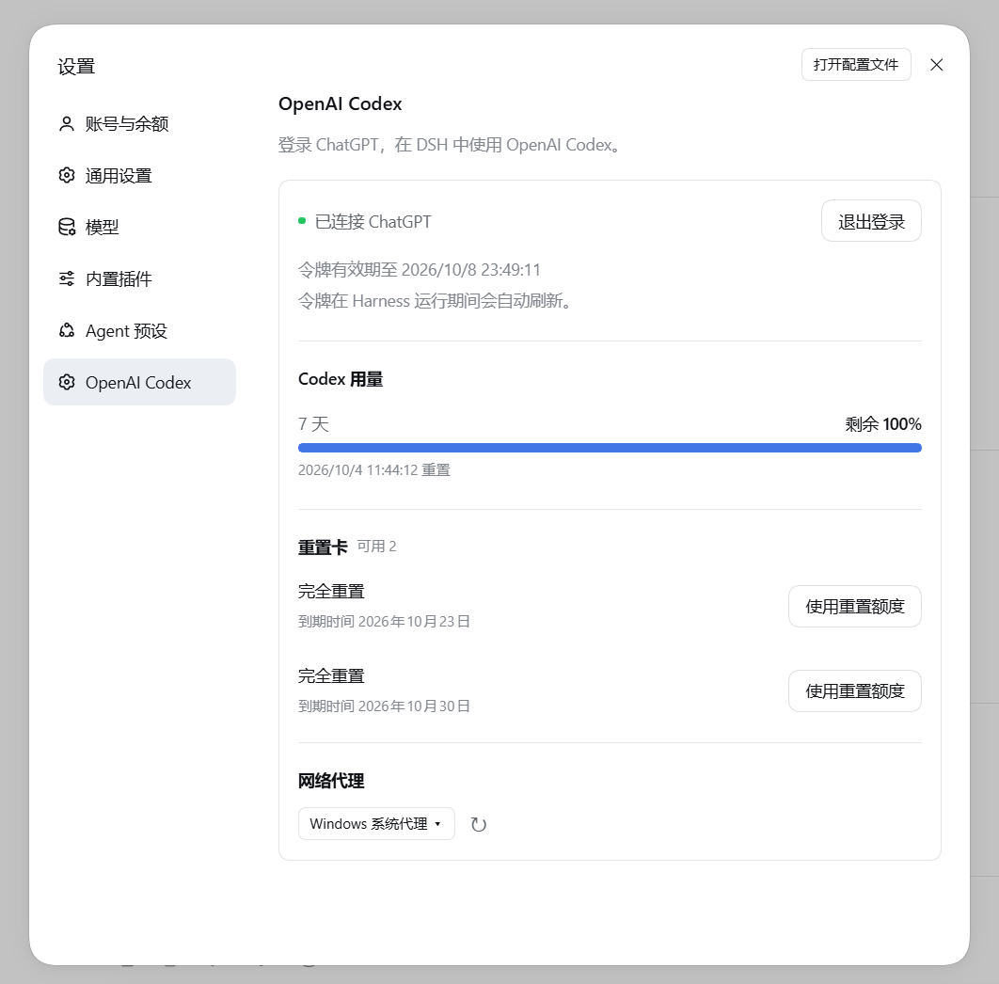

# dsh-openai-codex-auth

**简体中文** | [English](./README.md)

为 [DeepSeek Harness](https://github.com/deepseek-ai/deepseek-harness) 增加
`openai-codex` 模型提供方，通过符合资格的 ChatGPT 订阅登录，无需配置 OpenAI
Platform API Key。

如果当前配置启用了内置 `llm-pi-ai.providers.openai-codex` 路由，请先停用该路由，再启用本插件，避免提供方注册冲突。

<p align="center">
  
</p>

## 功能

- 使用 OpenAI Codex OAuth 设备码流程登录 ChatGPT；
- 在 DSH 模型选择器中提供 Codex 模型及对应推理等级；
- 在本地保存凭据并自动刷新令牌；
- 在设置页显示登录状态、滚动用量周期、重置时间和 Credits。
- 显示重置卡数量和到期时间，支持选卡并确认后兑换；
- 无需重启即可切换跟随 DSH 宿主或 Windows 手动系统代理。

## 要求

- DSH `0.2.0-rc.2`、`0.2.1-rc.2`、`0.2.1-rc.5` 或 `>=0.2.2-rc.1 <0.2.3-0`。
  Cordis 和 pi-ai 的兼容版本见 [package.json](./package.json)。
- CLI 安装需要 Node.js `>=22.19.0`。桌面版自带运行时。
- 具有 Codex 使用资格并已启用设备码登录的 ChatGPT 订阅。

可用模型取决于宿主的 pi-ai 目录和账号权限。Web 设置页已在 DSH `0.2.2-rc.5` 验证，
桌面版已验证 `0.2.2-rc.3` 的内置运行时。

## 安装或更新

### CLI / Web

```sh
dsh plugin --profile web add dsh-openai-codex-auth
```

安装或更新后重启 DSH。

### Windows 桌面版

通过桌面版插件管理器，在当前桌面版配置中安装或更新 `dsh-openai-codex-auth`。
如果应用提示重启，请重启桌面版。

### 从源码安装

CLI / Web 用户可在仓库根目录运行以下命令。

```sh
npm install
dsh plugin --profile web add .
```

桌面版用户可在插件管理器的「添加插件」对话框中输入本仓库的绝对路径。

## 使用

1. 打开“设置 → OpenAI Codex”，选择“使用 ChatGPT 登录”；
2. 打开验证页面，输入显示的设备码并完成授权；
3. 在模型选择器的“OpenAI Codex”下选择模型。

设置页跟随 DSH 的界面语言，提供英语、简体中文、日语、西班牙语、法语、德语、俄语和巴西葡萄牙语。

DSH agent 可以调用 `codex_login`、`codex_status` 和 `codex_logout`。工具输出使用 DSH 保存的语言偏好。
未保存偏好时使用宿主系统语言，遇到未支持的语言时使用英语。

### 重置卡

用量下方展示可用重置卡数量和每张可用 Codex 重置卡的到期时间（本地时区），最近到期的排在前面。
每行的“使用重置额度”按钮指定该张卡，确认弹窗也会显示所选卡的到期时间。
接口未提供有效期或详情读取失败时会明确提示，不会误显示为零张。
点击“使用重置额度”后需在弹窗再次确认，才会发送可能消耗所选重置卡的请求。
具体重置哪些符合条件的额度由服务端决定；所选卡失效时不会自动改用另一张。
结果不确定时只能重试同一次请求，请勿在其他窗口另行发起重置。
此功能依赖非公开接口，其兼容性不保证；兑换仅做模拟测试，未消耗真实重置卡验证。

### 网络代理

在 **设置 → OpenAI Codex → 网络代理** 中选择模式，新请求立即生效，无需重启
（底层配置字段为本插件的 `proxyMode`）：

- `host`（默认）：跟随 DSH 宿主。启动前配置 `HTTPS_PROXY` / `HTTP_PROXY` /
  `ALL_PROXY` 和 `NO_PROXY`，或写入 `$DSH_HOME/.env`。
- `system`：读取运行 DSH 的 Windows 用户的手动 HTTP/HTTPS 系统代理及绕过列表。
  登录、令牌刷新、用量和模型请求均使用此模式；模型对话使用 SSE，不使用 WebSocket。
  OAuth 在独立 Worker 内运行，不修改宿主的环境变量或全局连接管理器。

系统代理模式不支持 PAC、自动发现、SOCKS-only 或带用户名密码的代理地址；没有可用的
手动 HTTPS 代理时请求会报错，不会自动回退直连。系统绕过列表匹配的地址按系统策略直连。
此设置不控制外部浏览器中的授权页面。进行中的请求保留原连接直到结束；修改 Windows
代理后点击“重新读取系统代理”即可，切换失败保留原模式。修改宿主的环境变量仍需重启 DSH。

例如在 PowerShell 中（请替换为你的代理地址）：

```powershell
$env:HTTPS_PROXY = "http://127.0.0.1:7897"
dsh web
```

## 卸载

先在要卸载插件的配置中打开「设置 → OpenAI Codex」并退出登录。

Windows 桌面版用户可在应用内的插件管理器中卸载 `dsh-openai-codex-auth`，并按提示重启。

CLI / Web 用户运行以下命令，然后重启 DSH。

```sh
dsh plugin --profile web remove dsh-openai-codex-auth
```

## 旧版说明

DSH `0.1.7-rc.2` 用户请安装 `dsh-openai-codex-auth@0.4.2`。

### Windows 桌面版 `0.2.0-rc.2`

这个版本也可以使用桌面版自带的 CLI。先打开一次桌面版以初始化配置。如果要卸载，请先在设置中退出登录。
然后**完全退出桌面版**，包括托盘进程。在 PowerShell 中设置自带 CLI 的路径，自定义安装时请调整路径。

```powershell
$desktopDsh = "$env:LOCALAPPDATA\Programs\DeepSeek Harness\resources\runtime\cli\bin\dsh.cmd"
```

安装时运行以下命令。

```powershell
& $desktopDsh plugin --profile desktop add dsh-openai-codex-auth@0.6.7
```

如果要在这个版本中从源码安装，请在仓库根目录运行同一安装命令，并将包名替换为 `.`。

卸载时使用同一个自带 CLI 运行以下命令。

```powershell
& $desktopDsh plugin --profile desktop remove dsh-openai-codex-auth
```

安装或卸载完成后，重新打开桌面版。

## 安全

- OAuth token 以 `PI_OAUTH_OPENAI_CODEX` 项保存在本地
  `$DSH_HOME/.credentials.yaml`，不会发送到设置页面；
- 用量数据只保留聚合百分比、重置时间、Credits，以及重置卡数量、到期时间和选卡所需的卡片标识，不包含用户身份信息；
- 请勿提交或分享 `.credentials.yaml`、`auth.json` 或环境变量文件。

安全问题请按 [SECURITY.md](./SECURITY.md) 私下报告。

## 开发

```sh
npm run check
npm test
npm pack --dry-run
```

提交改动前请阅读 [CONTRIBUTING.md](./CONTRIBUTING.md)。

## License

[MIT](./LICENSE)
